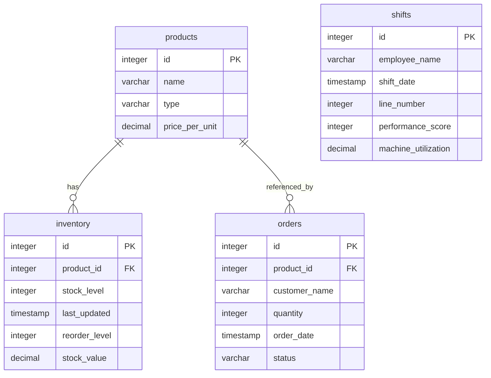

# 🏛️ AI Finance Manager
### Premium Indian Edition — Intelligent Corporate Financial Operating System

<p align="center"><strong>Luxury Financial Editorial × Modern Brutalism × AI-Powered Financial Intelligence</strong></p>

<p align="center">


</p>

## 📖 Overview

**AI Finance Manager — Premium Indian Edition** is an AI-powered financial management platform designed for Indian businesses. Built around the commercial environment of **Aura TexFab Mills Ltd.**, a textile manufacturing and trading enterprise based in Tiruppur, Tamil Nadu.

The platform combines financial accounting, corporate cash-flow monitoring, working-capital intelligence, GST reconciliation, predictive analytics, and conversational AI into one unified financial operating system.

Unlike conventional ERP platforms, this project focuses on financial intelligence and corporate financial control rather than production or inventory management.

### Core Capabilities

- Executive financial dashboards and KPI monitoring.
- General ledger and double-entry financial transactions.
- Corporate banking and liquidity management.
- Accounts Receivable (AR) and Accounts Payable (AP).
- AI-powered financial analysis and executive assistance.
- Predictive expenditure forecasting.
- Statistical spending anomaly detection.
- Indian GST reporting and reconciliation.
- Profit & Loss and Balance Sheet reporting.
- MySQL database architecture with SQLite fallback.

## 🎨 Design Philosophy

**Design Ethos:** Luxury Financial Editorial × Modern Brutalism × Intelligent Financial Terminal.

| Design Element | Specification |
|---|---|
| Primary Background | Warm Ivory `#F4F0E8` |
| Primary Accent | Wine `#481D2B` |
| Secondary Accent | Antique Brass `#A78A56` |
| Primary Text | Deep Charcoal `#191817` |
| Secondary Surface | `#EAE4D9` |
| Borders | `#D6CEC1` |
| Editorial Typography | Cormorant Garamond |
| Interface Typography | Inter |
| Financial Data | JetBrains Mono |

## 🇮🇳 Indian Financial Localization

| Parameter | Configuration |
|---|---|
| Company | Aura TexFab Mills Ltd. |
| Country | India |
| Currency | INR (₹) |
| GSTIN | `33AABCT1332L1Z4` |
| State | Tamil Nadu |
| Business Location | Tiruppur |
| Financial Year | FY 2026–27 |
| Financial Year Start | 01-04-2026 |
| Financial Year End | 31-03-2027 |
| Date Format | DD-MM-YYYY |

### Indian Number Formatting

All financial amounts use Indian numbering conventions:

```text
₹1,000.00
₹25,000.00
₹1,25,000.00
₹10,00,000.00
₹1,25,00,000.00
₹10,00,00,000.00
```

### GST Compliance

- GSTR-1 — Outward supply reporting.
- GSTR-3B — Summary tax liability and ITC reconciliation.
- CGST — Central Goods and Services Tax.
- SGST — State Goods and Services Tax.
- IGST — Integrated Goods and Services Tax.

Configured demonstration tax categories:

| Category | Demonstration Rate |
|---|---:|
| Cotton Fabric / Yarn | 5% |
| Synthetic Fabrics / Dyes | 12% |
| Commercial Services | 18% |

*GST rates are demonstration defaults. Actual applicability must be verified against current HSN/SAC classifications and GST notifications.*

Supported payment instruments: UPI, NEFT, RTGS, Net Banking, Cheque and Cash.

## ⚡ Platform Modules

### 01. Executive Financial Dashboard

- Total Revenue and Total Expenses.
- Net Operating Profit.
- Quick Liquidity (Bank + Cash).
- Accounts Receivable and Accounts Payable.
- Monthly Pacing Variance.
- Operating EBITDA Margin.
- Six-month Revenue vs. Outlay analytics.
- Cost Structure Doughnut Chart.
- Recent ledger postings.
- AI-generated executive financial summaries.

### 02. Financial Management & General Ledger

- Searchable general transaction ledger.
- Party, memo, account and category filters.
- Inflow and outflow classification.
- Custom date-range filtering and pagination.
- Journal voucher posting.
- Party GSTIN and payment instrument support.
- Automated GST calculations.
- Double-entry inter-account fund transfers.
- CSV import, export and NLP categorization.

### 03. AI Financial Intelligence Hub

**Conversational Financial Assistant**

Example queries:

```text
How much did the company spend this month?
What is our current net profit?
How much money is outstanding from customers?
What are our largest operating expenses?
How is cash flow changing?
What financial risks should management review?
```

Financial responses are designed to be grounded in application ledger aggregations.

**Predictive Spending Forecaster**

Uses Scikit-Learn LinearRegression to estimate future monthly operational expenditure.

Statistical indicators:

- Mean Absolute Error (MAE).
- Root Mean Squared Error (RMSE).
- Regression trend slope.
- Projected monthly expenditure.

**Spending Anomaly Detection**

A statistical Z-Score engine identifies unusual financial disbursements.

Configured threshold: `Z-Score > 2.5`.

**Corporate Risk Surveillance**

- Credit facility utilization.
- Customer receivable concentration.
- Working-capital lockup.
- Unusual expenditure movements.
- Raw material cost volatility.

### 04. Customers & Accounts Receivable

- Customer directory and GSTIN information.
- State jurisdiction and credit limits.
- Sales order references.
- Outstanding invoice balances.
- Payment collection modal.
- Collection history and settlement updates.

### 05. Suppliers & Accounts Payable

- Supplier directory.
- Ginning mills, polyester suppliers and chemical vendors.
- Packaging suppliers and electricity boards.
- Outstanding payable balances.
- Vendor bill tracking.
- Payment disbursement management.
- Automatic account deductions.

### 06. Statutory Financial Reports

**Profit & Loss — Ind AS Oriented**

- Revenue from operations.
- Cost of goods sold.
- Gross profit.
- Operating expenses.
- EBITDA.
- Net operating profit.

**Balance Sheet Summary**

Assets:
- Bank and cash balances.
- Accounts receivable.
- Inventory valuation.

Liabilities:
- Accounts payable.
- Cash credit facilities.
- Other recorded liabilities.

**GST Reconciliation**

- GSTR-1 outward turnover.
- GSTR-3B summary.
- Taxable turnover.
- CGST, SGST and IGST.
- Input Tax Credit claimed.

*Reports are management-oriented and require appropriate accounting adjustments and professional review before statutory use.*

### 07. Corporate Settings

- Registered company details.
- GSTIN configuration.
- Currency and financial-year settings.
- MySQL connection diagnostics.
- SQLite fallback status.
- AI engine parameters.

## 🗄️ Database Architecture

### Dual-Engine Database Resilience

| Database | Purpose |
|---|---|
| MySQL 8+ | Primary database |
| SQLite | Local development and fallback |

MySQL integration uses PyMySQL and connection pooling. SQLite provides local database operation when configured as a fallback.

*Production deployments should implement and test explicit replication, reconciliation and failover recovery rather than assuming automatic bidirectional synchronization.*

### MySQL Configuration

Create a `.env` file:

```env
USE_MYSQL=True
DB_USER=root
DB_PASSWORD=YOUR_ACTUAL_PASSWORD
DB_HOST=localhost
DB_PORT=3306
DB_NAME=textile_factory
```

Initialize the database:

```powershell
python init_mysql_database.py
```

## 📦 Textile Factory Sample Dataset

The application uses the publicly available **Textile Factory Orders, Products, Inventory and Shift Performance Dataset — Version 4** as a source of synthetic operational demonstration records.

**Dataset:** https://databasesample.com/datasets/textile-factory

**License:** CC0 1.0 Public Domain.

### Dataset Overview

| Table | Records | Description |
|---|---:|---|
| `products` | 100 | Textile products |
| `inventory` | 120 | Stock and inventory records |
| `orders` | 500 | Customer sales orders |
| `shifts` | 300 | Manufacturing shifts |
| **Total** | **1,020** | **Synthetic sample records** |

### Database Schema



### Download the MySQL Dataset

```powershell
Invoke-WebRequest `
  -Uri "https://database-sample-website.s3.eu-north-1.amazonaws.com/datasets/textile-factory/v4/sql/mysql.sql" `
  -OutFile "textile-factory-v4-sql-mysql.sql"
```

Create the database:

```sql
CREATE DATABASE textile_factory;
```

Import the SQL file:

```powershell
mysql -u root -p textile_factory < textile-factory-v4-sql-mysql.sql
```

### Download Individual CSV Files

```powershell
New-Item -ItemType Directory -Force -Path "data/textile-factory"

$base = "https://database-sample-website.s3.eu-north-1.amazonaws.com/datasets/textile-factory/v4/csv"

Invoke-WebRequest "$base/products.csv" -OutFile "data/textile-factory/products.csv"
Invoke-WebRequest "$base/inventory.csv" -OutFile "data/textile-factory/inventory.csv"
Invoke-WebRequest "$base/orders.csv" -OutFile "data/textile-factory/orders.csv"
Invoke-WebRequest "$base/shifts.csv" -OutFile "data/textile-factory/shifts.csv"
```

### Dataset Integration Notes

The original dataset supplies operational demonstration records, not a complete financial accounting ledger. It does not independently provide verified bank statements, real GSTIN records, journal vouchers, GST filings or actual corporate expenses.

The original dataset contains 2023 timestamps and must not be represented as actual FY 2026–27 financial activity.

Review the original SQL schema and confirm compatibility with the application's database schema before migration. Preserve existing application and user records.

## 🔄 Database Migration

### 1. Initialize MySQL

```powershell
python init_mysql_database.py
```

### 2. Migrate Textile Data

```powershell
python migrate_textile_mysql.py
```

The application migration is intended to integrate products, inventory, orders, shifts, customers, suppliers and tax records.

Migration requirements:

- Idempotent execution.
- Preservation of existing user data.
- Duplicate prevention.
- Foreign-key consistency.
- Data integrity verification.

### 3. INR Currency Migration

```powershell
python currency_migration.py
```

Configured historical conversion benchmark:

```text
1 USD = ₹83.50 INR
```

The migration is designed to maintain reversibility through `currency_migration_log`. The configured rate is a migration assumption, not a current RBI exchange quotation. Actual historical transactions should use applicable rates.

## 🧪 Automated Testing

Run the test suite:

```powershell
pytest -v test_app.py
```

### Test Coverage

| Test Area | Validation |
|---|---|
| Authentication | Login and password hashing |
| Transactions | Atomic balance adjustments |
| Deletion | Transaction reversal |
| Budgeting | Budget vs. actual calculations |
| Alerts | Budget overrun detection |
| Financial Goals | Completion velocity |
| CSV Import | Column normalization and categorization |
| NLP | Text classification accuracy |
| INR Formatting | Lakhs and Crores grouping |
| Executive Metrics | Revenue, expenses, AR and AP |
| AI Assistant | Database-grounded responses |
| Fund Transfers | Double-entry balance verification |

## 🚀 Installation & Quickstart

### Prerequisites

- Python 3.10 or newer.
- MySQL 8+ (optional when using SQLite).
- pip package manager.
- Git.

### Step 1 — Clone Repository

```bash
git clone https://github.com/YOUR_USERNAME/ai-finance-manager.git
cd ai-finance-manager
```

### Step 2 — Create Virtual Environment

Windows PowerShell:

```powershell
python -m venv venv
.\venv\Scripts\Activate.ps1
```

Linux/macOS:

```bash
python3 -m venv venv
source venv/bin/activate
```

### Step 3 — Install Dependencies

```bash
pip install -r requirements.txt
```

### Step 4 — Configure Environment

Create `.env` using the MySQL configuration above. Never commit real credentials or secret keys.

### Step 5 — Initialize Database

```powershell
python init_mysql_database.py
```

### Step 6 — Import Textile Dataset

Download and review the source SQL file, then import it into a compatible database. Run the application migration after confirming schema compatibility:

```powershell
python migrate_textile_mysql.py
```

### Step 7 — Run Currency Migration

Only if legacy USD-denominated records require conversion:

```powershell
python currency_migration.py
```

### Step 8 — Run Tests

```powershell
pytest -v test_app.py
```

### Step 9 — Start Application

```powershell
python app.py
```

Open:

**http://localhost:5000**

## 🔐 Demo Credentials

| User | Username | Password |
|---|---|---|
| Corporate Demo | `alice` | `password123` |
| Standard User | `bob` | `password123` |

- `alice` — Full Aura TexFab Mills demonstration profile.
- `bob` — Standard user demonstration profile.

**Security notice:** These are development credentials only. Change or disable them before deployment. Use secure password hashing, environment-based secrets and appropriate authorization controls.

## 📂 Suggested Repository Structure

```text
ai-finance-manager/
│
├── app.py
├── requirements.txt
├── README.md
├── .env.example
├── .gitignore
│
├── init_mysql_database.py
├── migrate_textile_mysql.py
├── currency_migration.py
├── test_app.py
│
├── data/
│   └── textile-factory/
│       ├── products.csv
│       ├── inventory.csv
│       ├── orders.csv
│       └── shifts.csv
│
├── database/
│   ├── schema.sql
│   └── migrations/
│
├── models/
├── routes/
├── services/
├── templates/
├── static/
│
└── instance/
    └── local.db
```

*Suggested structure; actual folders depend on implementation.*

## 🛡️ Security & Financial Integrity

Recommended production safeguards:

- Secure password hashing.
- Environment-based secret management.
- Role-based access control.
- Database transaction atomicity.
- Financial audit trails.
- Input validation and sanitization.
- SQL injection protection.
- Secure CSV import validation.
- Backup and recovery procedures.
- GST and accounting verification.
- AI response grounding against authorized financial records.

AI-generated financial insights should be reviewed by authorized management and accounting personnel before being used for business decisions.

## 🗺️ Future Development Roadmap

- [ ] Advanced AI financial copilot.
- [ ] Automated bank statement reconciliation.
- [ ] Real-time financial alerts.
- [ ] GST portal integration.
- [ ] Tally-compatible financial exports.
- [ ] Advanced cash-flow forecasting.
- [ ] Multi-company financial consolidation.
- [ ] Role-based executive dashboards.
- [ ] Automated financial report generation.
- [ ] Advanced audit and compliance monitoring.
- [ ] Production-grade database replication.
- [ ] Financial document intelligence.

## 📜 Dataset Attribution

**Textile Factory Orders, Products, Inventory and Shift Performance Dataset — Version 4**

- Publisher: DatabaseSample.
- Source: https://databasesample.com/datasets/textile-factory
- License: CC0 1.0 Public Domain.
- Dataset size: 1,020 rows across four tables.
- Data type: Synthetic demonstration data.

The sample dataset does not represent actual Aura TexFab Mills commercial transactions.

## 🤝 Contributing

Contributions, bug reports, feature suggestions and improvements are welcome.

1. Fork the repository.
2. Create a feature branch.
3. Implement your changes.
4. Run the automated test suite.
5. Submit a pull request with a clear description.

```bash
git checkout -b feature/your-feature-name
git add .
git commit -m "Add: your feature description"
git push origin feature/your-feature-name
```

---

<p align="center">
<strong>AURA TEXFAB MILLS LTD.</strong><br/>
<em>Intelligent Finance. Strategic Clarity. Corporate Control.</em><br/><br/>
Built for the next generation of Indian enterprise financial management.
</p>
